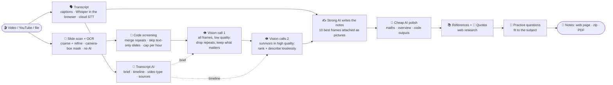

<div align="center">

# 🎓 Vid2Study

### Turn any lecture video into **study notes you actually want to read**

*Local-first. AI only writes. Every diagram, quote, formula and source stays in.*

<br>


**[✨ What you get](#-what-you-get)** · **[🧠 How it works](#-how-it-works)** · **[🎭 Who does what](#-who-does-what-cheap-vs-strong)** · **[🚀 Install](#-install-in-2-minutes)** · **[🖱 Using it](#-using-it)** · **[🔒 Privacy](#-privacy-and-safety)**

</div>

---

## ✨ What you get

You point it at a lecture. It hands you back notes with the **why before the how**, a worked example for every idea, real LaTeX maths, code that shows its output, step-by-step diagrams for algorithms, the slides that matter in the right place, every **quote** and **source** the speaker names, and **hard practice questions** that fit the subject.

| | |
|---|---|
| 🧾 **Easy first** | Hard ideas are explained in plain words, then precisely, with an example a newcomer can follow. Short punchy lines, a bit of humour, zero filler. |
| ➗ **Real maths** | Every formula is LaTeX (KaTeX, bundled). Derivations are solved step by step with the reason for each step, and each symbol is defined. |
| 💻 **Code that runs** | Every code block is followed by its **Output**. Algorithms (sorting, searching, BFS/DFS, Dijkstra…) are *executed* and drawn phase by phase. |
| 🖼 **Figures in the right place** | Diagrams, charts, tables, code and formulas are never dropped. Other frames appear only when the writer decides the notes need them. |
| 💬 **Quotes, kept apart** | A quote shown on screen always gets its own `> **Quote:**` callout, at the moment it appears. |
| 📚 **Sources and references** | Books, papers, films, documents and cited people are noted where they come up and collected in a **References** section, with background found by a web search. |
| 🧠 **Practice questions that fit** | JEE/GATE-style numericals for maths and physics, LeetCode/FAANG problems for code, *understanding* questions for history and religion. The writer judges what fits. |
| 📦 **Bulk notes** | On a university LMS course page, tick a whole week (or "Without notes") and queue every lecture at once. |
| 🛟 **Never loses your work** | Everything is saved as it goes. If a model fails the job **pauses**, you pick another model, and it resumes from where it stopped. |
| 🖨 **Takes it with you** | Copy as text (raw LaTeX), a `.zip` that works offline, or print to a clean PDF. |

---

## 🧠 How it works

> **The one idea:** heavy work happens on *your computer* with plain algorithms. A model only ever sees what it needs, and the expensive one only does the writing.



<details>
<summary><b>🔬 The stages in detail</b></summary>

<br>

1. **Transcript.** Page captions or a `.vtt`/`.srt` when they exist. Otherwise the audio is transcribed: **Whisper in the browser** (free, private, slow on very long audio) or an optional **cloud speech-to-text** model (Groq, OpenAI or any OpenAI-compatible `/audio/transcriptions`). Large MP4/M4A/WAV files are read piece by piece with flat memory, so a 12-hour file is fine. YouTube captions come from the page's own player, then `yt-dlp` in the bridge, then audio download.
2. **Trim, losslessly.** Fillers, stutters, sound tags and recognition loops are removed by code; timestamps stay. A transcript still longer than ~3 hours is also tightened by the Cheap AI, which may only drop repetition.
3. **Slide scan.** The video is sampled every ~2 s (every 2nd sample first, the ones between only where something changed). A learned **motion mask** ignores the presenter's camera box, and the best moment of each scene is picked (still, sharp, fully drawn in).
4. **OCR and a no-AI classifier.** Tesseract reads each frame; edge and layout analysis flags code, tables, diagrams and formulas.
5. **Code screening.** Repeats and step-by-step build-ups are merged, blank frames dropped, plain text slides OCR already read skip the AI, and the rest is capped per hour, spread over the whole video.
6. **Transcript AI.** One model reads the whole transcript (plus six frames from start to end) and returns a **brief**, a detailed **timeline**, the **video type** (technical or not) and every **source** mentioned.
7. **Vision, in very few calls.** *Call 1* looks at **all** candidate frames at low quality in one request (thousands fit) and drops repeats, blur, titles and half-drawn animation states. A code check rescues any drop that names no replacement. *Calls 2* (at most two) look at the survivors in high quality, with the transcript timeline, and rank and describe each in lossless detail. Every image is labelled in three ways (a text line, the id printed on the picture, the prompt list) so captions can never slip onto a neighbouring frame.
8. **Write.** Up to 60 minutes the **Strong AI** writes everything in one pass; longer lectures it reads the full transcript in 2–3 parts. The ten best frames are attached as **pictures**; every other frame is offered as a description, and it adds one only if it finds it necessary, in one compact line the code places.
9. **Finish.** Maths is fixed in one batched call, the overview and code outputs come from the Cheap AI, quotes are guaranteed, the References section is written, and practice questions are added when the subject calls for them.

</details>

---

## 🎭 Who does what (cheap vs strong)

Slots can use **any provider and model**. Empty slots fall back sensibly, so you can start with one key and refine later.

| Slot | Job | Good choices | If empty |
|---|---|---|---|
| ✍️ **Strong AI** *(+ one fallback)* | Writes the notes, the References section and the practice questions | a top-tier model (Claude Sonnet, Gemini Pro/"neon"…) | required |
| 🪙 **Cheap AI** *(+ any number of fallbacks)* | Trims very long transcripts, fixes maths, writes the overview, predicts code outputs | Gemini Flash-Lite, Haiku, a local Ollama model | the Strong AI |
| 👁 **Vision AI** | Screens and describes frames (many images per call) | Gemini Flash-Lite (takes thousands of images) | the Cheap AI |
| 📝 **Transcript AI** | Brief, timeline, video type and sources from the transcript + 6 frames | a cheap long-context model | the Cheap AI |
| 🎙 **Speech-to-text** | Transcribes audio when there are no captions | Groq `whisper-large-v3-turbo` | Whisper on your computer |

The **Cheap AI is a pool**: if one model fails (rate limit, quota, outage) the next one answers, in the order you list them. The **Strong AI** is a pool of two. A model that answers 401/403/404 is skipped for the rest of the run, and the job only pauses when every model in a pool has failed.

---

## 📝 What the notes look like

```markdown
### The Night Berlin Split (00:00)
> **Quote:** “Forget not the tyranny of this wall ... nor the love of freedom that made it fall ...” — Unknown, Graffiti on the Berlin Wall

- **Big idea:** On August 13, 1961, East Germany sealed off Berlin overnight.
- **Key points:**
  - Construction kept going for a decade, slicing through neighbourhoods.
  - The Wall divided Germany and symbolised a split world.


> **Source:** *The Basic Treaty of 1972* — FRG & GDR (West Germany recognised East Germany)
> **Watch out:** the Wall kept people *in*, it was never built to keep an army out.
> **Quick check:** why did a wall through a city beat a fence along a border?

## References
- **The Basic Treaty of 1972** — treaty between the two Germanys: ...
```

Callouts you will meet: `Example` · `Extra example` · `Analogy` · `Extra (beyond the lecture)` · `Watch out` · `Quick check` · `Shortcut` · `Quote` · `Source` · `Unclear`.

---

## 🚀 Install in 2 minutes

1. **Get the code** and keep the folder somewhere permanent (Chrome loads it from there):
   ```bash
   git clone https://github.com/pranaychdey20-lab/Vid2Study.git
   ```
2. Open `chrome://extensions`, switch on **Developer mode**, click **Load unpacked**, and choose the folder that contains `manifest.json`.
3. Click the toolbar icon → **Options** → **AI providers**. **Paste just a key**: the service is recognised from its format (Gemini `AIza…`, Groq `gsk_…`, Anthropic `sk-ant-…`, OpenAI `sk-…`) and its models load by themselves.
4. Pick your **Strong**, **Cheap**, **Vision** (and optionally **Transcript**, **Speech-to-text**) models and save.
5. *(Optional)* In the extension's **Details**, turn on **Allow access to file URLs** so saved lectures are reused instead of fetched again.

> 💡 **Cheapest good start:** Strong = a strong writer, everything else on one Gemini Flash-Lite key. Leave Cheap/Vision/Transcript empty and they all follow the Cheap AI.

<details>
<summary><b>🔌 Use your subscriptions instead of API keys: the local bridge (optional)</b></summary>

<br>

A Chrome extension can't start a CLI or a browser, so three extra providers go through a tiny helper in [`bridge/`](bridge) (Node 18+):

| Provider | What it uses | Notes |
|---|---|---|
| **Claude CLI** | your Claude subscription via `claude -p`, stripped to ~1K tokens per call | text and images (as temporary files) |
| **Gemini web** | your signed-in gemini.google.com | plain HTTP after a one-time sign-in; pictures too |
| **Langdock** | your workspace's models (GPT, Claude, Gemini…) | plain HTTP after a one-time sign-in |

```bash
cd bridge
npm install
npm start          # prints a token; paste it as the provider's API key
```

On Windows, double-click `bridge/Start-Bridge.cmd` (or run `node setup.mjs`) and it checks Node, Chrome, the Claude CLI and your sign-ins, and installs what's missing. Restart the bridge after you change anything in `bridge/`.

⚠️ **Security:** the bridge only answers `chrome-extension://` pages that send its token. `bridge/profile/`, `bridge/*-session.json` and `bridge/token.txt` hold your sign-ins: they are git-ignored. **Never share or commit them.** Google's terms restrict automated use of the consumer app, so keep the volume low.

</details>

---

## 🖱 Using it

- **Sites.** The extension only runs on sites you enable (defaults: the university LMS it was built with, and YouTube; add your own in Options → Sites). Use the toolbar icon → *Enable on this site*, or *Scan this page now* for a one-off.
- **The NOTES button.** Any page with a video gets a small button, bottom right: **DOWNLOAD**, **SUMMARIZE**, **CAPTIONS**.
- **📚 Lectures drawer (university LMS).** Open a course page and click **LECTURES**. Every lecture is grouped by module and chapter. Tick a **whole week** with one click, or press **Without notes** to select everything not yet summarised, then **Summarize selected (N)**. They run one after another; a failure never stops the rest, and the queue survives a restart.
- **From a file.** *Options → Summarize from a file…* takes a video or audio file (and an optional `.vtt`/`.srt`).
- **YouTube.** The transcript is found without listening whenever possible (the page's player, then `yt-dlp`). Figures come from the video itself, and link back with "Watch at".
- **Results page.** Copy text (raw LaTeX), **Bundle .zip** (`summary.md`, an offline `summary.html`, `images/`, `frames.json`) or **Print → Save as PDF**.
- **Activity log.** One collapsible block per job, with the time each stage took.

---

## 🧪 Tests

No dependencies, no browser:

```bash
npm test
```

It runs the pure logic (chunking, alignment, scene detection, the frame classifier, the dedup rules, the screening review, figure placement, quotes and references, model pools, the MP4 audio reader, cloud transcription) and the **whole pipeline end to end with a fake AI**. What it can't cover (Whisper, Tesseract, canvas, WebCodecs, the real provider APIs) is listed in [`CLAUDE.md`](CLAUDE.md), which is also the contributor guide.

---

## 🔒 Privacy and safety

- API keys live in `chrome.storage.local` and go only to their own provider, in a header. They are never logged.
- Transcription, slide detection and OCR run **on your computer**. Only text and the frames you choose are sent to the AI you configured. The video file itself is never uploaded.
- `host_permissions` is `<all_urls>` because videos live on many hosts and AI endpoints are configurable. The content script only runs on sites you enable.
- It never tries to break DRM, and only downloads direct files you can already play. Use it for personal study and follow your institution's and the video site's rules.

---

## 🩺 Troubleshooting

<details>
<summary><b>Common problems</b></summary>

<br>

- **No NOTES button.** The site isn't enabled: toolbar icon → *Enable on this site*, then reload.
- **"Add an API key…" / "Choose a … model".** Fix it in Options; the page opens by itself.
- **Model list stays empty.** Check the key and URL (OpenAI-compatible URLs usually end in `/v1`); the status line under the provider shows the error.
- **A model failed mid-run.** The job pauses; a window lets you switch the model or skip the stage, then it continues from the saved draft.
- **"Failed to fetch" with a bridge provider.** The bridge isn't running (or was restarted): start it, or use *Start bridge* in Options.
- **Notes are slow with Gemini web.** Thinking models take a while; use a `-low` model for cheap jobs.
- **Frames look wrong or missing.** While the testing option *Save a debug dump* is on, the results page has a **Debug dump** button: every frame shows whether the code merged it, which AI call kept or dropped it, and why.
- **"Could not download the video (HTTP 403)".** The link expired or the Referer check failed: reload the lecture page.
- **A formula shows as text.** KaTeX couldn't parse it; the rest is unaffected, and *Copy text* has the raw LaTeX.

</details>

---

## 🗂 Project map

```
Vid2Study/
├─ manifest.json            MV3 manifest (no build step, plain ES modules)
├─ background.js            service worker: job queue, site registration, Referer rules
├─ offscreen.js             hidden worker page that runs a job
├─ content.js + adapters/   the floating UI and per-site code (university LMS, YouTube, generic)
├─ options.* · results.*    settings and the notes viewer / export
├─ lib/
│  ├─ local-pipeline.js     ⭐ the main pipeline (resumable, pauses on model failure)
│  ├─ prompts.js            every prompt
│  ├─ scan.js · scenes.js   slide scan, scene detector, motion mask
│  ├─ ocr.js · framekind.js OCR and the no-AI frame classifier
│  ├─ asr.js · stt.js       Whisper in the browser, cloud speech-to-text
│  ├─ llm.js                Gemini / OpenAI-compatible / Anthropic / bridge providers
│  ├─ algoviz.js            runs real algorithms and draws every step
│  └─ vendor/               Whisper (transformers.js), ONNX runtime, Tesseract, KaTeX
├─ bridge/                  optional local helper: Claude CLI, Gemini web, Langdock, yt-dlp
└─ tests/                   `npm test`: pure logic + the pipeline with a fake AI
```

---

## 📄 License

[MIT](LICENSE) © 2026 pranaychdey20-lab. Free to use, change and share; keep the license notice.

---

<div align="center">

**Built for students who would rather understand a lecture than transcribe it.** 🎓

<sub>Personal-study tool · Chrome MV3 · plain JavaScript · made with a lot of lecture videos</sub>

</div>
